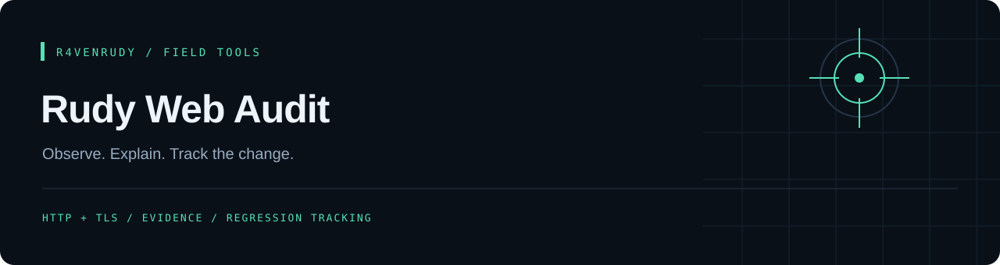
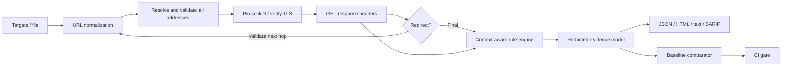
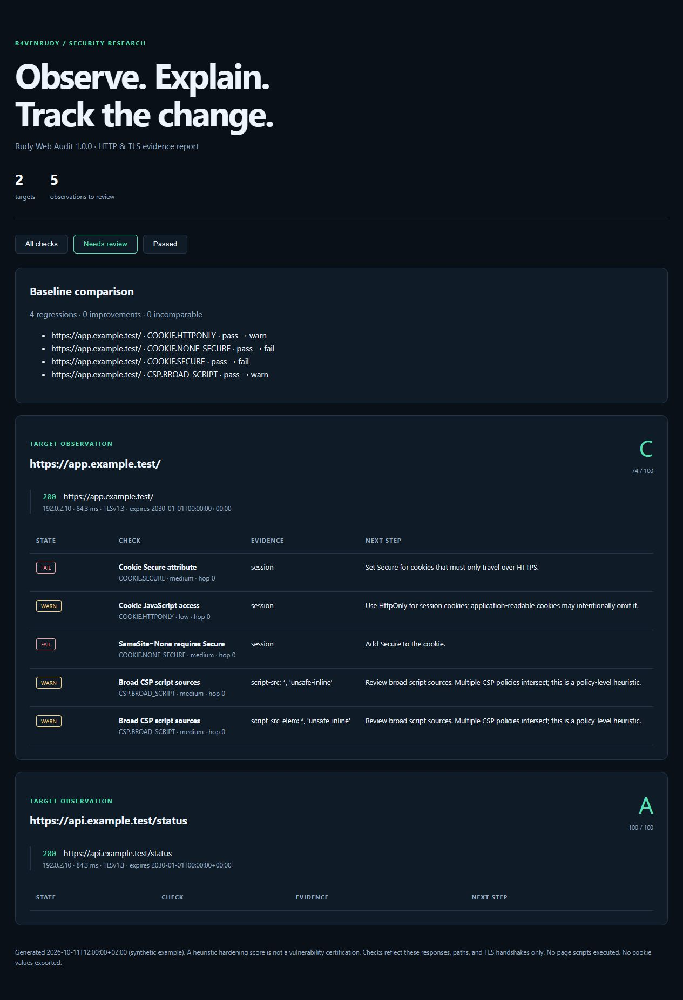

<p align="center"></p>

<p align="center">
  
  
  <a href="https://github.com/r4venrudy/rudy-web-audit/actions/workflows/ci.yml"></a>
  <a href="LICENSE"></a>
</p>

<p align="center"><strong>Evidence-first HTTP/TLS reconnaissance and security regression tracking.</strong><br>Trace every redirect. Explain each observation. Catch the next regression.</p>

<p align="center"><a href="#quick-start">Quick start</a> · <a href="#capabilities">Capabilities</a> · <a href="#compare-two-scans">Compare scans</a> · <a href="#architecture">Architecture</a> · <a href="docs/methodology.md">Methodology</a></p>

---

Rudy Web Audit turns HTTP responses and TLS handshakes into a reviewable evidence trail. It inspects each redirect hop, evaluates browser hardening policies in context, and produces terminal, JSON, interactive offline HTML, or SARIF reports. A saved JSON scan becomes a baseline for future regression gates.

The tool uses Python's standard library. It makes bounded GET requests, reads response headers, and closes the connection without consuming the page body. It does not execute page scripts or carry a cookie jar between requests.

## Capabilities

| Layer | What you get |
| :--- | :--- |
| Transport | Certificate and hostname verification, negotiated TLS version/cipher, certificate expiry and SHA-256 fingerprint |
| Redirects | Per-hop status, address and timing; loop detection, HTTPS downgrade findings, cross-host observations |
| Browser policies | HSTS value checks, enforcing vs. report-only CSP, script-source heuristics, framing, MIME sniffing and referrer privacy |
| Cookies | Separate Set-Cookie inspection, Secure/HttpOnly/SameSite checks, prefix constraints, plaintext cookie observations |
| Evidence | Stable rule IDs, severity, explanations, recommendations and deduplicated hardening scores |
| Workflows | Concurrent target lists, saved baselines, regression/improvement comparison and configurable exit codes |
| Reporting | Escaped interactive HTML with no external resources, versioned JSON and SARIF 2.1.0 output |
| Request boundaries | Public-address checks on every hop, validated DNS addresses pinned to the connection, bounded concurrency and redirect count |

## Quick start

Requires **Python 3.10+**. No API keys or third-party runtime packages.

```bash
git clone https://github.com/r4venrudy/rudy-web-audit.git
cd rudy-web-audit
python -m rudy_web_audit https://example.com
```

Optional installation into your virtual environment:

```bash
python -m pip install .
rudy-web-audit https://example.com --format html --output reports/audit.html
```

Open the generated HTML file in your browser. The filter buttons work offline.

## Bulk reconnaissance

Create `targets.txt` with one URL or hostname per line. Blank lines and lines beginning with `#` are ignored.

```text
# Sites you administer
https://example.com
https://www.example.com
```

```bash
python -m rudy_web_audit --targets-file targets.txt --workers 4 --timeout 10 --format json -o reports/current.json
```

Hostnames without a scheme default to HTTPS. Private, loopback, link-local and other non-public destinations are blocked; use `--allow-private` when testing your own local network.

## Compare two scans

```bash
python -m rudy_web_audit https://example.com --format json -o reports/baseline.json
python -m rudy_web_audit https://example.com --baseline reports/baseline.json --format html -o reports/comparison.html --fail-on regression
```

Comparison uses the normalized target identity, rule ID and hop index; cookie rules also use the cookie name. It reports regressions, improvements, added/removed targets and incomparable scans. An incomplete scan cannot become an apparent improvement. The regression gate returns an error when baseline coverage changes or a target cannot be compared.

Generate SARIF for a CI artifact or a compatible analysis viewer:

```bash
python -m rudy_web_audit https://example.com --format sarif -o reports/web-audit.sarif --fail-on high
```

The SARIF contains web observations with stable fingerprints. These are remote-resource observations rather than source-code locations; viewer support for findings without file locations varies.

## CLI reference

| Option | Default | Purpose |
| :--- | :--- | :--- |
| `--targets-file FILE` | — | Read additional targets from UTF-8 text |
| `--workers N` | `4` | Concurrent targets, from 1 to 16 |
| `--timeout SECONDS` | `10` | Socket-operation timeout, from 0.1 to 60 |
| `--max-redirects N` | `5` | Follow up to 0–10 redirects |
| `--allow-private` | Off | Explicitly permit private/local destinations |
| `--format FORMAT` | `text` | `text`, `json`, `html` or `sarif` |
| `--output FILE`, `-o FILE` | Standard output | Save a report; parent folders are created |
| `--baseline FILE` | — | Compare with a schema-version-1 JSON scan |
| `--fail-on LEVEL` | — | Fail on `low`, `medium`, `high`, `critical` or `regression` |

At most 200 distinct input targets are accepted. Normalization-equivalent inputs may still be scanned separately. `--fail-on` considers warning and failure observations at or above the threshold.

| Exit code | Meaning |
| :--- | :--- |
| `0` | Complete scan; configured gate passed |
| `1` | Complete scan; configured finding or regression gate failed |
| `2` | Invalid input, network/TLS failure, incomplete scan or incomparable regression gate |
| `130` | Interrupted |

## Architecture



## Report preview

The repository includes a **synthetic** two-target report: an HTML application with a policy regression and a JSON endpoint with context-specific checks. No real target results are implied.



Open [examples/demo.html](examples/demo.html) locally, or inspect [examples/demo.json](examples/demo.json). Regenerate both with `python examples/generate_demo.py`.

## Validation

```bash
python -m unittest discover -s tests -v
```

Tests exercise real local HTTP and TLS servers, redirect boundaries, policy edge cases, report redaction and escaping, baseline behavior, and CLI exit codes. CI runs the suite on Linux, Windows and macOS with supported Python versions.

## Interpretation and limits

The score is a **hardening heuristic**, not a vulnerability certification. A missing header does not prove an exploitable flaw. CSP inspection is static and does not implement the complete browser policy algorithm; multiple policies intersect and application context matters. Non-HTML responses skip HTML-specific checks.

Only the requested paths, returned headers, and negotiated TLS connections are observed. There is no TLS protocol enumeration, cipher sweep, revocation check, JavaScript execution or exploit testing. DNS resolution uses the operating system and is not bounded by the socket timeout; a slow server can also extend total wall-clock time across individual socket operations.

Cookie values, query values, unknown headers and raw CSPs are omitted or redacted in exports. Target hostnames, paths, cookie names, addresses and selected header values remain visible; do not include secrets in URL paths. Full normalized URLs are represented by SHA-256 target IDs for comparison; hashes of predictable values are not anonymization.

Use on systems you own or are authorized to assess. See [methodology](docs/methodology.md) for scoring and evidence details.

## Contributing

Include a reproducible fixture and a focused regression test when changing a rule. Keep transport verification enabled, preserve duplicate response headers, and document any new report fields. See [CONTRIBUTING.md](CONTRIBUTING.md).

## License

[MIT](LICENSE) · Part of the [r4venrudy](https://github.com/r4venrudy) tool collection.
